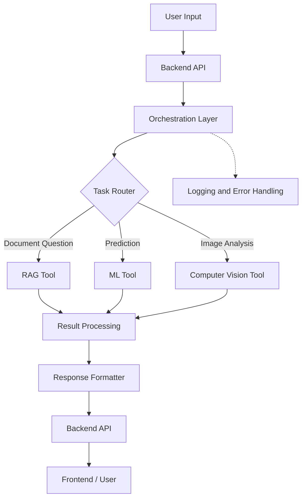

# AI Orchestration Layer
### Unified Coordination for RAG, Machine Learning, and Computer Vision

## Overview

The **AI Orchestration Layer** is a software component that coordinates multiple AI subsystems through a unified interface. It receives user requests, identifies the appropriate processing workflow, invokes the required tools, manages their outputs, and returns structured responses.

The architecture integrates three specialized subsystems:

- **Retrieval-Augmented Generation (RAG):** Retrieves relevant information from a document collection and generates context-grounded answers.
- **Machine Learning (ML):** Performs prediction and classification using trained models.
- **Computer Vision (CV):** Processes images using vision models for supported visual analysis tasks.

Instead of requiring users to interact with each subsystem independently, the orchestration layer provides a centralized mechanism for routing and coordinating tasks.

> **Core principle:** The orchestration layer coordinates execution; specialized tools and models perform the actual AI tasks.

## Objectives

- Provide a unified interface for multiple AI capabilities.
- Route requests to the appropriate subsystem.
- Support modular integration of different models and tools.
- Coordinate sequential or conditional workflows.
- Standardize outputs from different subsystems.
- Improve maintainability through separation of responsibilities.
- Provide a foundation for monitoring, error handling, and future AI integrations.

## System Architecture



### Component Responsibilities

| Component | Responsibility |
|---|---|
| Frontend | Collects user input and displays results. |
| Backend API | Receives requests and invokes the orchestration service. |
| Orchestration Layer | Coordinates tool selection and execution. |
| Task Router | Determines which subsystem should handle a request. |
| RAG Tool | Retrieves relevant documents and generates grounded responses. |
| ML Tool | Runs trained models for prediction or classification. |
| Computer Vision Tool | Processes images using vision models. |
| Result Processor | Validates and normalizes tool outputs. |
| Response Formatter | Produces a consistent response for the frontend. |

## How It Works

The orchestration workflow consists of the following stages.

### 1. Request Ingestion

The backend receives a request containing a task, question, dataset, or image.

### 2. Task Identification

The orchestration layer determines the required operation using predefined rules, an LLM-based router, or workflow configuration.

### 3. Tool Selection

The router selects the appropriate subsystem based on the request and the available tools.

Examples:

- Questions about indexed documents → RAG.
- Numerical predictions → ML.
- Image-based analysis → Computer Vision.

### 4. Tool Execution

The selected tool receives the necessary input and executes its processing pipeline. This may involve document retrieval, model inference, image preprocessing, or other task-specific operations.

### 5. Result Processing

The orchestration layer receives the tool output, handles execution errors, and validates the response where appropriate.

For more complex workflows, it can invoke additional tools in a defined sequence.

### 6. Response Delivery

The processed result is returned through the backend API and displayed to the user.

## Routing Strategies

The architecture can support different routing approaches depending on the application's requirements.

### Rule-Based Routing

Uses predefined conditions to select a tool. This is suitable for simple, predictable workflows.

### LLM-Based Routing

Uses a language model to interpret natural-language requests and select from a controlled set of available tools.

The LLM should not be allowed to execute arbitrary functions. Tool selection and execution should be validated by the application.

### Workflow-Based Orchestration

Executes multiple tools in a predefined sequence or based on intermediate results.

Example:

1. Computer Vision identifies visible features in an image.
2. An ML model estimates a risk category using supported input features.
3. RAG retrieves relevant reference documents.
4. The orchestration layer combines the outputs into a structured response.

Each stage should be implemented only when the required integrations are available.

## Example Implementation

The following example demonstrates a minimal rule-based orchestrator in Python.

```python
def rag_tool(question):
    # Replace with the actual RAG pipeline.
    return {
        "tool": "rag",
        "result": "Document-based answer"
    }


def ml_tool(data):
    # Replace with the actual trained ML model.
    return {
        "tool": "ml",
        "result": "Prediction result"
    }


def cv_tool(image):
    # Replace with the actual CV pipeline.
    return {
        "tool": "computer_vision",
        "result": "Image analysis result"
    }


def orchestrate(request):
    task = request.get("task")

    if task == "document_question":
        return rag_tool(request["question"])

    if task == "prediction":
        return ml_tool(request["data"])

    if task == "image_analysis":
        return cv_tool(request["image"])

    return {
        "error": "Unsupported task"
    }


if __name__ == "__main__":
    request = {
        "task": "image_analysis",
        "image": "building.jpg"
    }

    print(orchestrate(request))
```

**Note:** The tool functions above are placeholders. They must be connected to actual retrieval pipelines and trained models before the system can perform real AI inference.

## Project Structure

A possible modular project structure is:

```text
ai-orchestration-layer/
├── app/
│   ├── main.py
│   ├── api/
│   │   └── routes.py
│   ├── orchestration/
│   │   ├── orchestrator.py
│   │   ├── router.py
│   │   └── workflows.py
│   ├── tools/
│   │   ├── rag_tool.py
│   │   ├── ml_tool.py
│   │   └── cv_tool.py
│   ├── schemas/
│   │   └── requests.py
│   └── services/
│       └── response_processor.py
├── tests/
│   ├── test_router.py
│   └── test_orchestrator.py
├── requirements.txt
├── .env.example
└── README.md
```

This is a suggested structure, not a claim about an existing repository.

## Installation and Setup

### Prerequisites

- Python 3.10 or a compatible version supported by your dependencies.
- pip and a virtual environment.
- The dependencies required by your selected AI models and tools.

### 1. Clone the Repository

```bash
git clone <YOUR_REPOSITORY_URL>
cd ai-orchestration-layer
```

Replace the placeholder with your actual repository URL.

### 2. Create a Virtual Environment

**Windows:**

```powershell
python -m venv .venv
.venv\Scripts\activate
```

**Linux / macOS:**

```bash
python3 -m venv .venv
source .venv/bin/activate
```

### 3. Install Dependencies

```bash
pip install -r requirements.txt
```

The dependency list should reflect the actual framework, model libraries, and integrations used in the project.

### 4. Configure Environment Variables

Create a `.env` file if your integrations require credentials or configuration.

Example:

```env
LLM_API_KEY=
VECTOR_DATABASE_URL=
MODEL_PATH=
```

These are illustrative placeholders. Add only the variables required by your implementation. Never commit API keys, passwords, or other secrets to version control.

### 5. Run the Application

If the project uses FastAPI and exposes an application instance named `app` in `app/main.py`, start it with:

```bash
uvicorn app.main:app --reload
```

The actual command depends on the application's entry point and framework.

## API Design

A possible unified endpoint is:

`POST /api/orchestrate`

Example request:

```json
{
  "task": "document_question",
  "input": {
    "question": "Summarize the relevant document."
  }
}
```

Example response:

```json
{
  "success": true,
  "tool": "rag",
  "result": "Document-based answer"
}
```

The request and response schemas must be adapted to the actual backend implementation. Image uploads and structured ML inputs may require different validation and transport formats.

## Error Handling and Reliability

A production implementation should include:

- Input validation before tool execution.
- Explicit handling of unsupported task types.
- Timeouts for model and external service calls.
- Consistent error responses.
- Logging of task execution and failures.
- Authentication and authorization where required.
- Limits on file size, request rate, and computational resources.
- Validation of model outputs before presenting them as reliable results.

Sensitive inputs, credentials, and private document contents should not be written to logs unnecessarily.

## Testing

The orchestration layer should be tested independently of the underlying AI models wherever possible.

| Test | Purpose |
|---|---|
| Router tests | Verify that requests select the correct tool. |
| Input validation tests | Reject missing or invalid inputs. |
| Tool integration tests | Verify correct invocation and response handling. |
| Failure tests | Check behavior when a tool times out or fails. |
| Workflow tests | Validate the order of multi-tool execution. |
| API tests | Verify request and response contracts. |

Mock tool functions can be used to test routing without requiring expensive model inference.

## Advantages

- **Modularity:** Each subsystem can be developed and maintained independently.
- **Extensibility:** Additional tools can be registered without redesigning the entire application.
- **Centralized coordination:** Routing, validation, and execution policies can be managed in one place.
- **Consistency:** Results can be normalized into a common response format.
- **Flexibility:** Different routing strategies can be used for different tasks.

## Limitations

- Routing mistakes can invoke an inappropriate tool.
- Multiple model calls can increase latency and computational cost.
- External APIs and model services can fail independently.
- LLM-based routing may be nondeterministic.
- The orchestration layer does not automatically improve the accuracy of the underlying models.
- Multi-tool workflows require careful validation of intermediate outputs.

## Future Enhancements

- Integrate LLM-based tool selection with controlled function calling.
- Add workflow graphs for conditional and parallel execution.
- Implement observability, tracing, and execution metrics.
- Add caching for suitable repeated requests.
- Introduce authentication, rate limiting, and role-based access controls.
- Support asynchronous execution for long-running inference tasks.
- Evaluate routing accuracy, latency, failure rate, and end-to-end task success.

## Conclusion

The AI Orchestration Layer provides a unified coordination mechanism for specialized AI subsystems. By separating routing and workflow management from model execution, the architecture makes it easier to integrate, test, and extend RAG, Machine Learning, and Computer Vision capabilities.

The effectiveness of the system depends on the quality of its routing logic, the reliability of its integrations, and the performance of the underlying models.

## License

Add the license applicable to your repository before distributing the project.

